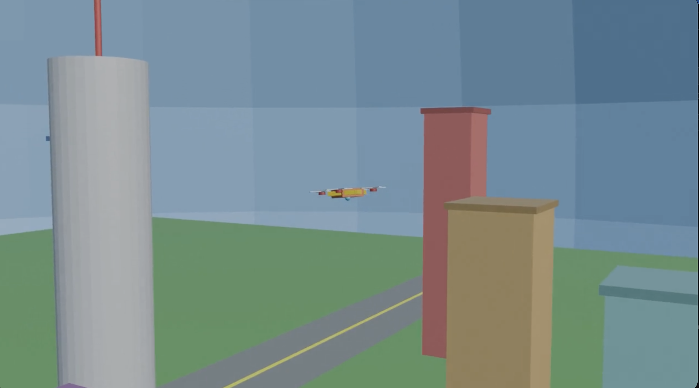

# 🚁 Procedural 3D Drone Animation

A Python-driven 3D drone animation created using **Blender and its Python API (`bpy`)**. This project explores procedural 3D modelling, keyframe animation, camera tracking, and the creation of a city environment.

The entire scene is generated programmatically using Python, from the drone and its propellers to the surrounding buildings, roads, lighting, and animation.

## 🎬 Animation Preview



▶️ **[Watch the Drone Animation](drone_animation_output0000-0200.mp4)**

## 🌆 Project Overview

The project features a 3D drone flying through a procedurally generated urban environment.

The drone follows a circular flight path around a central tower while moving vertically to create a hovering effect. Its propellers rotate continuously, and the camera dynamically tracks the drone throughout the animation.

### Key Features

- **Procedural Drone Modelling:** A drone constructed using Blender's mesh primitives, including a body, four arms, motors, propellers, and a sensor.
- **Animated Flight Path:** Circular movement with vertical oscillation and rotation.
- **Propeller Animation:** Continuously rotating propeller blades using keyframe animation.
- **Procedural City Environment:** Buildings with different dimensions and colours, a central tower, and an antenna.
- **Environment Design:** Ground plane, road, road markings, and surrounding sky.
- **Dynamic Camera Tracking:** A camera that continuously follows the drone's movement.
- **Lighting:** Sun and point lights to illuminate the scene.

## 🛠️ Technologies Used

| Technology | Purpose |
|---|---|
| Python | Procedural scene generation and animation |
| Blender | 3D modelling, animation, and rendering |
| `bpy` | Blender Python API for creating and manipulating scene objects |
| `math` | Mathematical calculations for flight paths and rotation |
| `mathutils` | Vector calculations and camera tracking |

## 🎞️ Animation Specifications

| Specification | Value |
|---|---|
| Frame range | 0–200 |
| Frame rate | 24 FPS |
| Resolution | 1280 × 720 |
| Animation type | Procedural keyframe animation |
| Output format | MP4 |
| Video codec | H.264 |

## 📂 Project Structure

```text
blender-procedural-drone-animation/
├── assignment_3.py
├── drone_animation_output0000-0200.mp4
├── README.md
└── drone_animation_preview.png
```

## 🚀 How to Run

### Requirements
- Blender 3D
- Python scripting support through Blender

### Instructions

1. Clone this repository:

   ```bash
   git clone https://github.com/YOUR-USERNAME/blender-procedural-drone-animation.git
   ```

2. Open Blender.
3. Navigate to the **Scripting** workspace.
4. Open `assignment_3.py`.
5. Run the script to generate the complete 3D scene and animation.
6. Press `Ctrl + F12` to render the animation.

## 💡 Learning Outcomes

Through this project, I explored:

- Procedural 3D modelling using Python
- Hierarchical object parenting
- Keyframe-based animation
- Mathematical motion and circular trajectories
- Dynamic camera tracking using vectors
- Scene composition and environmental modelling
- Lighting and video rendering

## 👩‍💻 Author

Created as part of my computer science and 3D animation journey.

---

*Built with Python and Blender.*
